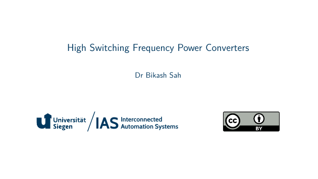
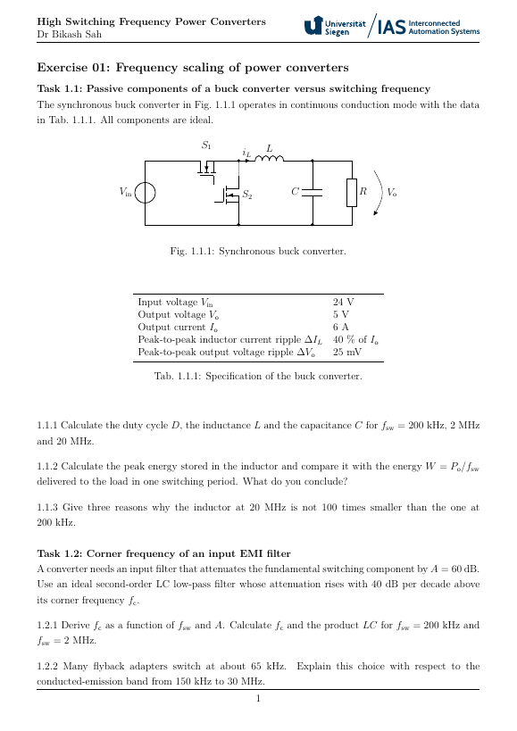
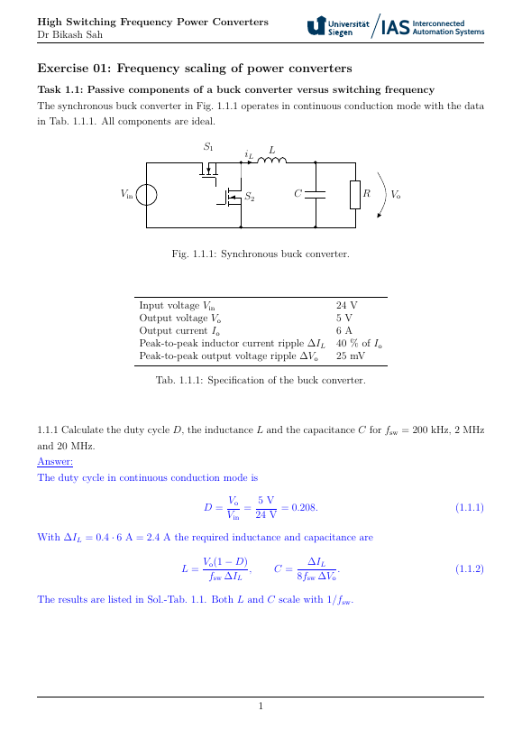

# High Switching Frequency Power Converters

[](https://github.com/IAS-Uni-Siegen/High_SFPC/actions/workflows/BuildPDFs.yml)
[![CC BY 4.0][cc-by-shield]][cc-by]
[](https://www.python.org/)
[](https://www.latex-project.org/)

This work is licensed under a
[Creative Commons Attribution 4.0 International License][cc-by].

[![CC BY 4.0][cc-by-image]][cc-by]

[cc-by]: http://creativecommons.org/licenses/by/4.0/
[cc-by-image]: https://licensebuttons.net/l/by/4.0/88x31.png
[cc-by-shield]: https://img.shields.io/badge/License-CC%20BY%204.0-lightgrey.svg

## Folder structure for latex and code templates and jupyter notebook files:
```plaintext
HSFPC_course-+- lecture  +- tex          # Contains the lecture latex files
             |           +- fig + lec[i] # Figures of lecture i: Inkscape SVG sources, exported PDFs, plot data
             +- exercise +- tex          # Contains the exercise latex files and
             |           |               # the jupyter notebooks without solution
             |           +- fig + ex[i]  # Circuit figures of exercise i (circuitikz)
             |           +- code + ex[i] # Contains the jupyter notebooks with solutions
             +- course_template          # Submodule IAS-Uni-Siegen/course_template
```

The dedicated jupyter notebook files with solutions are added after the tutorial has taken place.

Figures are drawn in circuitikz, pgfplots or TikZ directly in the tex files wherever possible. All other diagrams are Inkscape SVG files in `lecture/fig/lec[i]`. After editing an SVG, export it as PDF with the same file name (Inkscape: File > Save a Copy > PDF).

## Lecture slides (click on preview picture)
<a href="https://ias-uni-siegen.github.io/High_SFPC/lecture.pdf" target="_blank" class="image fit"></a>

The covered topics are:
- Why high switching frequency? Scaling laws and the voltage-current-power-frequency map
- The HF switching cell: loss inventory and device selection
- Parasitics and PCB layout of the commutation cell
- Gate drivers for fast-switching devices
- Measurement and characterisation at high frequency
- HF magnetics: materials, core loss, performance factor, windings, planar and integrated magnetics
- Soft switching without resonance
- Resonant converters: SRC, PRC, LLC, CLLC, VHF inverters, rectifiers and matching networks
- Case studies and teardown
- Switched-capacitor and hybrid converters
- Modelling and control at high frequency
- EMI, thermal design and integration

## Exercise tasks (click on preview picture)
<a href="https://ias-uni-siegen.github.io/High_SFPC/exercise.pdf" target="_blank" class="image fit"></a>

## Exercise tasks including solutions (click on preview picture)
<a href="https://ias-uni-siegen.github.io/High_SFPC/exercise_with_solution.pdf" target="_blank" class="image fit"></a>

## Building locally
```bash
cd lecture  && pdflatex main.tex   # slides (handout mode, as set by the template)
cd exercise && pdflatex main.tex   # exercise sheets; remove [solution] for the version without solutions
```
`build.py` in both folders creates the PDFs in `built/` (as on GitHub Actions).

If you start the git repository from this folder, replace the local copy of the template by the submodule:
```bash
git init
rm -r course_template
git submodule add https://github.com/IAS-Uni-Siegen/course_template.git course_template
```

## Citation
See "Cite this repository" info box on the top-right or use the following BibTeX entry for citing it:
```
@misc{Sah_HSFPC_2026,
    author = {Sah, Bikash},
    title = {{High Switching Frequency Power Converters}},
    url = {https://github.com/IAS-Uni-Siegen/High_SFPC},
    year = {2026}
}
```
